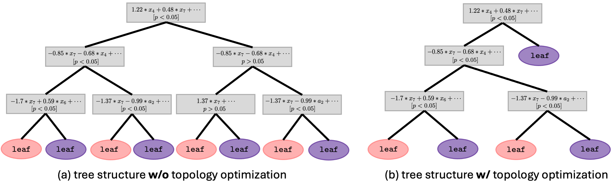
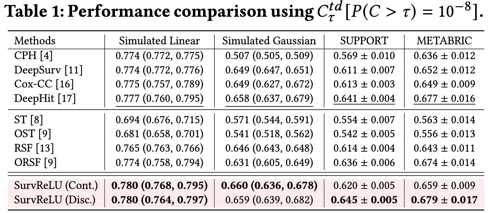
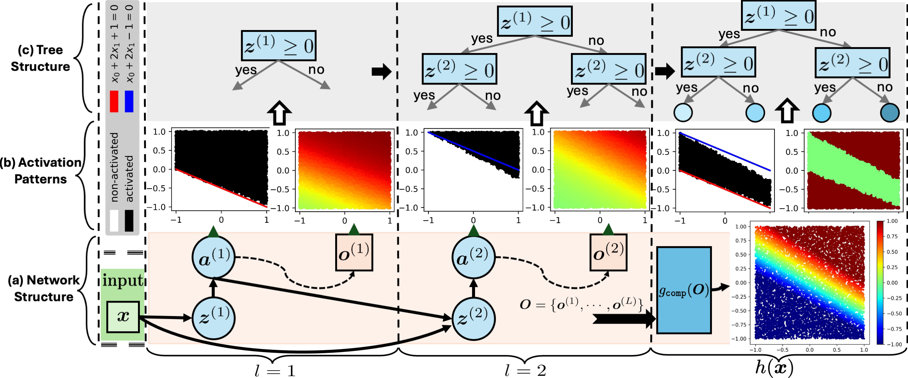

# [CIKM '24] SurvReLU: Inherently Interpretable Survival Analysis via Deep ReLU Networks 
[](https://www.repostatus.org/#active) [](https://arxiv.org/abs/2407.14463)

## News :fire:
- **July 16, 2024:** Congratulations! This paper has been accepted by CIKM 2024  $\color{lightgreen} \textbf{[acceptance rate = 27\\%]}\%$ !

  



> **Abstract.** 
Survival analysis models time-to-event distributions with censorship. Recently, deep survival models using neural networks have dominated due to their representational power and state-of-the-art performance. However, their "black-box" nature hinders interpretability, which is crucial in real-world applications. In contrast, "white-box" tree-based survival models offer better interpretability but struggle to converge to global optima due to greedy expansion. In this paper, we bridge the gap between previous deep survival models and traditional tree-based survival models through deep rectified linear unit (ReLU) networks. We show that a deliberately constructed deep ReLU network (SurvReLU) can harness the interpretability of tree-based structures with the representational power of deep survival models. 
Empirical studies on both simulated and real survival benchmark datasets show the effectiveness of the proposed SurvReLU in terms of performance and interoperability.

> **Network Architecture**  



## Usage

### 1. Environment

Python 3.10 is recommended. The main training script currently uses CUDA tensors,
so install a CUDA-enabled PyTorch build when training on a GPU.

```bash
python3.10 -m venv .venv
source .venv/bin/activate
python -m pip install --upgrade pip
python -m pip install -r requirements.txt
```

### 2. Data

The repository includes the simulated HDF5 datasets under `datasets/`. The real
benchmarks are loaded through `pycox` and support the following names:

- `metabric`
- `support`
- `flchain`
- `gbsg`

The supported simulated names are `simulated_linear`, `simulated_linear_2d`,
`simulated_gaussian`, and `simulated_gaussian_2d`.

### 3. Train SurvReLU

Train on a real benchmark with:

```bash
python train_real_dataset.py \
      --dataset metabric \
      --depth 4 \
      --epochs 50 \
      --batch-size 128 \
      --optimizer SGD \
      --lr 0.1
```

The best validation checkpoint is written to `viz/best_<dataset>.pth`. See all
training options with:

```bash
python train_real_dataset.py --help
```

`run_nsotree.py` contains the pycox-based SurvReLU experiment used for the
simulated and benchmark comparisons. Select its `dataset` variable from the names
above before running:

```bash
python run_nsotree.py
```

### 4. Baselines and visualizations

The top-level `run_cph.py`, `run_COXMLP.py`, `run_DeepHit.py`, `run_rsf.py`, and
`run_survival_tree.py` scripts reproduce the corresponding baselines. Plotting
and tree-inspection utilities are named `viz_*.py` and `vis_tree.py`. These
experiment scripts keep their dataset and output settings near the top of each
file so runs can be reproduced explicitly.

### Repository layout

| Path | Purpose |
| --- | --- |
| `models/` | SurvReLU and neural survival model implementations |
| `baselines/` | Survival tree and random survival forest implementations |
| `utils/` | Dataset loading, argument parsing, logging, and visualization helpers |
| `datasets/` | Included simulated and benchmark data files |
| `checkpoint/` | Curated experiment checkpoints |
| `viz/` | Evaluation outputs and generated figures |
| `DeepSurv/` | Vendored DeepSurv baseline and its original license |

## Acknowledgements

This code is built on the top of [pycox](https://github.com/havakv/pycox) and [locally constant network](https://github.com/guanghelee/iclr20-locally-constant-nets), we thank their efficient and neat codebase. 

## Citation
If you find our work is useful in your research, please consider raising a star  :star:  and citing:

```
@misc{sun2024survreluinherentlyinterpretablesurvival,
      title={SurvReLU: Inherently Interpretable Survival Analysis via Deep ReLU Networks}, 
      author={Xiaotong Sun and Peijie Qiu and Shengfan Zhang},
      year={2024},
      eprint={2407.14463},
      archivePrefix={arXiv},
      primaryClass={cs.LG},
      url={https://arxiv.org/abs/2407.14463}, 
}
```
